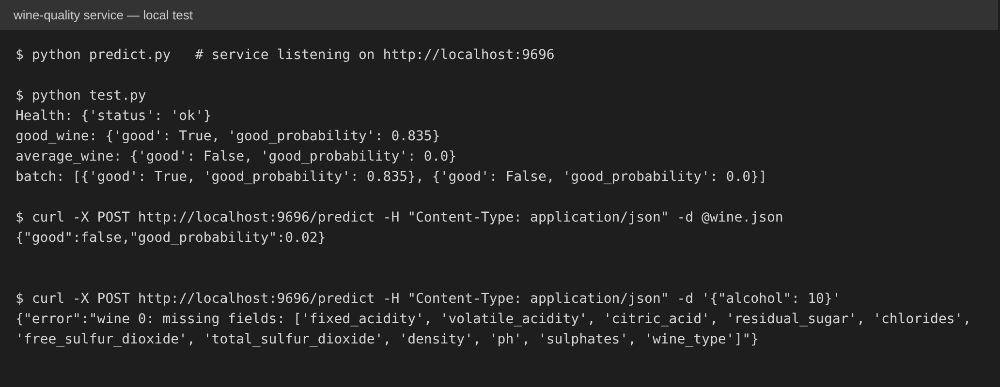

# 🍷 Wine Quality Prediction — Is this a *good* wine?

ML Zoomcamp midterm project: predict whether a wine will be rated **good** by expert tasters using only routine lab measurements, and serve the model as a web service in Docker.

## Problem description

Expert tasting panels are slow and expensive, but every wine batch already goes through standard physicochemical lab analysis (acidity, sugar, sulfur dioxide, alcohol, ...). If a model can estimate tasting quality from those numbers, a winery or wine buyer can:

* **prioritise** which batches are worth sending to the tasting panel,
* **flag** promising batches early for a premium label,
* give winemakers **fast feedback** while blending.

We frame this as **binary classification**: `good = 1` if the expert score is **≥ 7** (out of 10), otherwise `0`. About 19% of wines are "good". The model returns `P(good)`, so users can pick their own threshold. For example, a lower threshold sends more candidates to the panel.

**Metric:** ROC AUC (classes are imbalanced), plus precision and recall at the chosen threshold.

## Dataset

[UCI Wine Quality](https://archive.ics.uci.edu/dataset/186/wine+quality) (P. Cortez et al., 2009). 6,497 Portuguese *Vinho Verde* wines (1,599 red + 4,898 white), 11 physicochemical features + a quality score.

The data is committed in [`data/`](data/) (`winequality-red.csv`, `winequality-white.csv`, `winequality.names`). To download it yourself:

```bash
wget https://archive.ics.uci.edu/static/public/186/wine+quality.zip
unzip wine+quality.zip -d data/
```

| Feature | Description |
|---|---|
| fixed_acidity | tartaric acid, g/dm³ |
| volatile_acidity | acetic acid, g/dm³ (too much tastes like vinegar) |
| citric_acid | g/dm³ |
| residual_sugar | g/dm³ |
| chlorides | sodium chloride, g/dm³ |
| free_sulfur_dioxide | mg/dm³ |
| total_sulfur_dioxide | mg/dm³ |
| density | g/cm³ |
| ph | pH |
| sulphates | potassium sulphate, g/dm³ |
| alcohol | % vol |
| wine_type | `red` or `white` (added when combining the two files) |

## Approach and results

All steps are in [`notebook.ipynb`](notebook.ipynb):

1. **Data preparation:** combined red + white, normalised column names, no missing values, **removed 1,177 duplicate rows (18%)** so the same wine can't appear in both train and test. 60/20/20 stratified split.
2. **EDA and feature importance:** distributions by class, correlation matrix, risk ratio and mutual information. **Alcohol** is by far the strongest signal (r ≈ 0.42 with the target), followed by density and chlorides. `wine_type` adds little on its own.
3. **Models tuned on the validation set**, then compared with 5-fold CV on train + validation:

| Model | Tuned parameters | Val AUC | 5-fold CV AUC |
|---|---|---|---|
| Logistic Regression (scaled) | C | 0.816 | 0.829 ± 0.015 |
| Decision Tree | max_depth, min_samples_leaf | 0.797 | 0.808 ± 0.021 |
| **Random Forest** | n_estimators, max_depth, min_samples_leaf, max_features | **0.838** | **0.848 ± 0.013** |
| Gradient Boosting (HistGradientBoosting) | learning_rate, max_depth, min_samples_leaf, l2, n_iter | 0.831 | 0.842 ± 0.013 |

4. **Final model:** Random Forest (`n_estimators=200`, `max_features='sqrt'`, fully grown trees). **Test ROC AUC = 0.846.** At a threshold of 0.5: precision 0.64, recall 0.38 for the *good* class. A threshold of ~0.3 gives better recall if the goal is to catch most good wines.

## Project structure

```
├── README.md
├── data/                  # dataset (red + white CSVs)
├── notebook.ipynb         # cleaning, EDA, feature importance, model selection & tuning
├── train.py               # trains the final model -> model.bin
├── predict.py             # Flask web service
├── test.py                # sends sample requests to the service
├── wine.json              # sample request body
├── Pipfile                # dependencies (Pipenv)
├── requirements.txt       # same dependencies for pip / Docker
├── Dockerfile
└── images/service_test.png
```

## How to run

### 1. Set up the environment

With Pipenv:

```bash
pip install pipenv
pipenv install --dev        # creates Pipfile.lock
pipenv shell
```

Or with pip:

```bash
python -m venv .venv && source .venv/bin/activate
pip install -r requirements.txt
```

### 2. Train the model

```bash
python train.py
```

This runs 5-fold CV, reports the test AUC, refits on all data and saves `(DictVectorizer, model)` to `model.bin`.

### 3. Run the web service locally

```bash
python predict.py                              # development server on :9696
# or, production-style:
gunicorn --bind 0.0.0.0:9696 predict:app
```

### 4. Run with Docker

The image trains the model during the build, so the pickle always matches the installed scikit-learn version.

```bash
docker build -t wine-quality .
docker run -it --rm -p 9696:9696 wine-quality
```

### 5. Send requests

```bash
python test.py                                  # health check, single and batch predictions

curl -X POST http://localhost:9696/predict \
     -H "Content-Type: application/json" \
     -d @wine.json
```

**Request:** one wine object (or a JSON list of them):

```json
{
  "fixed_acidity": 7.0, "volatile_acidity": 0.27, "citric_acid": 0.36,
  "residual_sugar": 20.7, "chlorides": 0.045, "free_sulfur_dioxide": 45,
  "total_sulfur_dioxide": 170, "density": 1.001, "ph": 3.0,
  "sulphates": 0.45, "alcohol": 8.8, "wine_type": "white"
}
```

**Response:**

```json
{"good": false, "good_probability": 0.02}
```

Invalid input (missing fields, wrong types, unknown `wine_type`) returns HTTP 400 with an error message. The decision threshold can be changed with the `THRESHOLD` environment variable (default `0.5`).

### Interacting with the service



## Cloud deployment (bonus)

The Dockerfile reads `$PORT`, so it runs unchanged on most container platforms. For example, on **[Render](https://render.com)** (free tier):

1. Push this folder to a GitHub repository.
2. In Render: **New → Web Service**, connect the repo, choose **Docker** as the runtime.
3. Deploy. Render builds the image and gives you a URL like `https://wine-quality-xxxx.onrender.com`.
4. Test it: `python test.py https://wine-quality-xxxx.onrender.com`

The same image works on Fly.io (`fly launch`), Google Cloud Run (`gcloud run deploy --source .`) or AWS Elastic Beanstalk.
